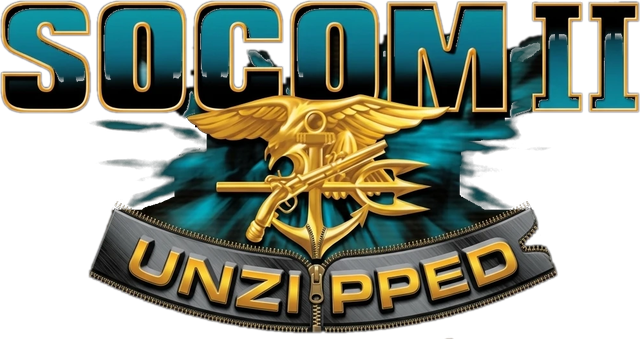
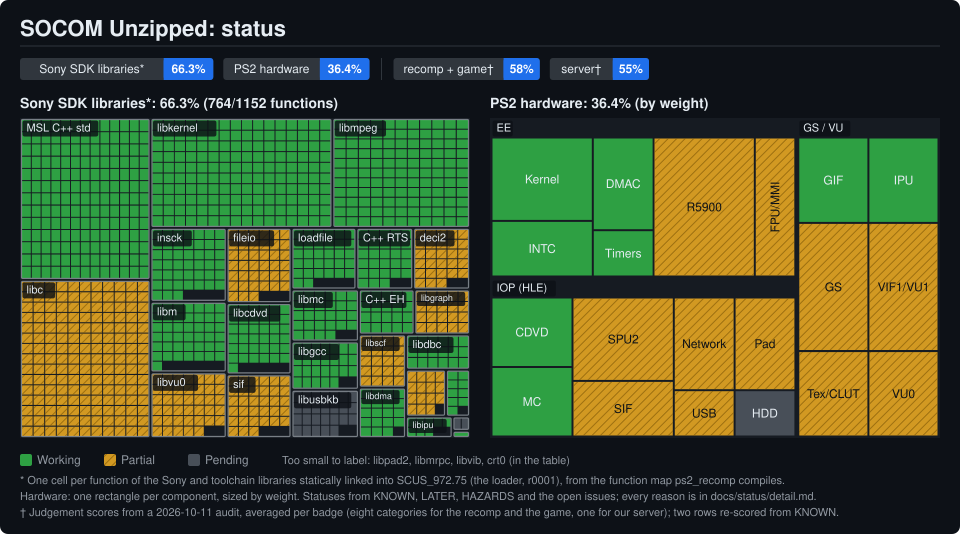
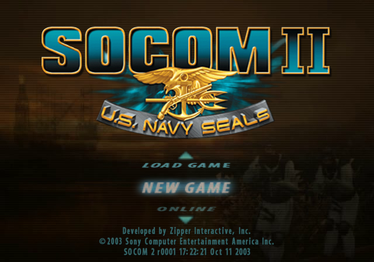
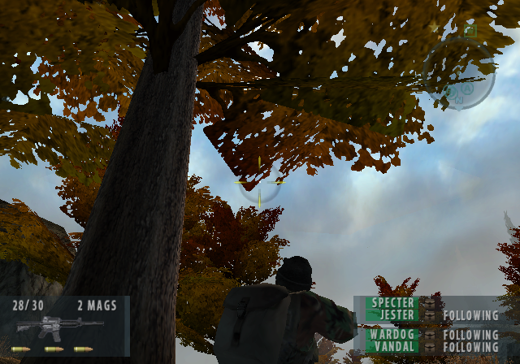
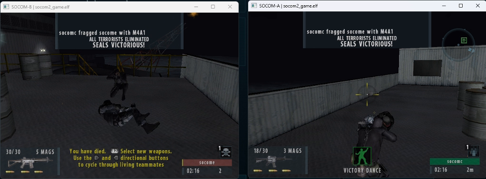
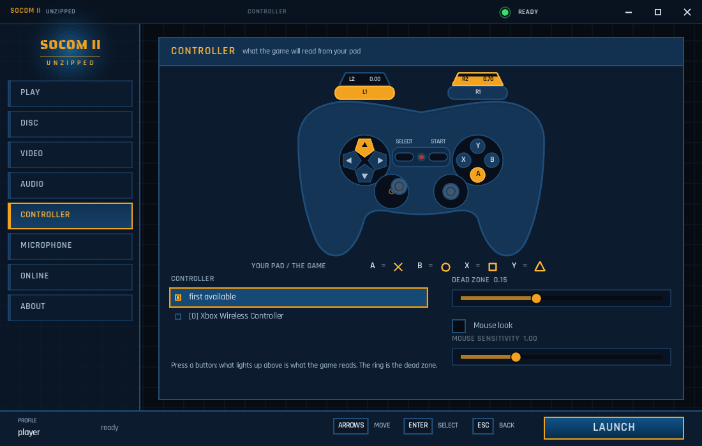
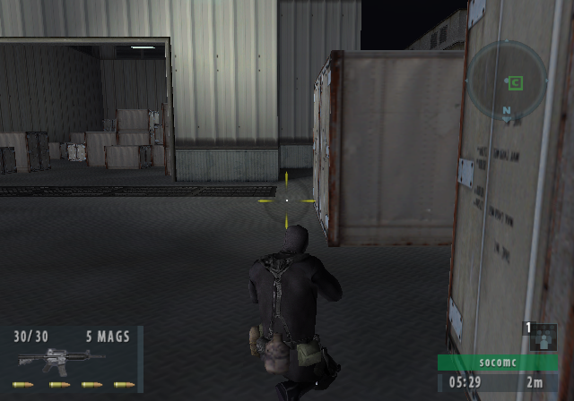
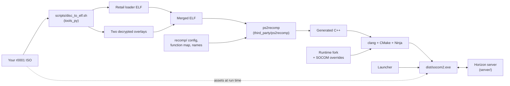

<div align="center">



# SOCOM Unzipped

**SOCOM II: U.S. Navy SEALs, statically recompiled from your own disc into a native PC program, with online play.**

[](LICENSE)


-experimental-orange?logo=apple&logoColor=white)

[](https://github.com/Scotho/socom-unzipped/tags)

[](https://socomunzipped.com)

[](https://github.com/Scotho/socom-unzipped/actions/workflows/linux.yml)
[](https://github.com/Scotho/socom-unzipped/actions/workflows/windows.yml)
[](https://github.com/Scotho/socom-unzipped/actions/workflows/macos.yml)
[](https://github.com/Scotho/socom-unzipped/actions/workflows/secrets.yml)

</div>

A green CI badge means everything that builds without the game built and passed its tests on a clean machine. The
game itself is checked on the maintainer's machine, with a disc.

---

> [!IMPORTANT]
> **This repository contains no game code and no game data**: not the executable, not the recompiled C++, not
> textures, audio, movies or saves. You need **your own copy** of the US retail release of SOCOM II (`SCUS-97275`,
> disc revision r0001); the recompiled program is built by each developer from their own disc, and the release will
> carry the program, never the disc's own files (#70). A contribution that adds any game data is closed unread
> (`CONTRIBUTING.md`).

> [!WARNING]
> **Multiplayer disclaimer.** Online play is at your own risk. The game's network code is twenty years old,
> recompiled as it was, and it runs as a native program on your PC. Some known problems have been addressed and
> others have not; what is known, and what to do if you find something, is in `SECURITY.md`. Play only with people
> you trust, on the project's test server or one you run yourself, never with a build you did not compile or verify,
> and not yet against a community server: the launcher does not offer one until it can install the r0004 update (see
> [Current status](#current-status)).

> [!NOTE]
> **Early stage.** This is a working prototype, not a finished port. It boots, plays the menus and the missions, and
> two copies of the game have finished online rounds against each other on the project's test server, driven by the
> project's own test harness on one machine. No two people have played each other yet, audio still has rough edges,
> and things break between builds. Read [Current status](#current-status) before you expect anything.

## Contents

- [What is this?](#what-is-this)
- [Current status](#current-status)
- [Where the project is heading](#where-the-project-is-heading)
- [For players: get it](#for-players-get-it)
- [For developers](#for-developers)
  - [Requirements](#requirements)
  - [Building and running](#building-and-running)
  - [How it works](#how-it-works)
  - [Repository layout](#repository-layout)
- [Documentation](#documentation)
- [Contributing and security](#contributing-and-security)
- [License and credits](#license-and-credits)

## What is this?

| | |
|---|---|
| **A static recompilation** | The game's PS2 executable is translated to C++ once and compiled natively; the result runs the game's own code as a normal Windows (and, in progress, Linux) program. There is no PS2 emulator underneath -- the runtime provides the hardware the code expects (EE kernel, DMA, a software/OpenGL GS, VU1, the IOP services), and SOCOM-specific hooks on top of that. |
| **Your own disc** | The game reads its assets from the ISO of the US retail release (`SCUS-97275`, disc revision r0001); the launcher verifies the disc before it will launch. |
| **Online play, headed for the community's servers** | The game's original network (DNAS / Medius) is gone. The community runs its own servers on the game's later r0004 revision, and that is where players will play once the launcher can install that update on your machine (#71). Until then the project runs a [Horizon Private Server](https://github.com/Horizon-Private-Server/horizon-server) of its own as a test box, so builds are checked against something known; the launcher points at it by default (`socom.scotho.com`). |
| **Not affiliated** | with Sony Interactive Entertainment, Zipper Interactive, or the SOCOM community servers. SOCOM is their trademark; this is a fan project for people who own the disc. |

## Current status

<p align="center">
  <a href="docs/status/detail.md"></a>
</p>
<p align="center"><sub>Green works with nothing open recorded against it (it may still be unverified against a console); amber has an open defect or a recorded divergence, or is a stub that answers the game without the real behaviour; grey is not working or not modelled. An unproven candidate is named but does not count. Every library's and component's reason is in <a href="docs/status/detail.md">the table</a>, read from <code>docs/KNOWN.md</code> (which wins), <code>docs/LATER.md</code>, <code>docs/HAZARDS.md</code> and the open issues. Edit <code>docs/status/status.toml</code> and regenerate with <code>python -m tools_py.status_map</code>. The idea and the look come from <a href="https://github.com/KIexster/god-of-war-recomp">KIexster/god-of-war-recomp</a>.</sub></p>

Screenshots from the project's own builds (native Windows, OpenGL renderer):

<p align="center">
  
  
</p>
<p align="center">
  
</p>
<p align="center">
  
  
</p>
<p align="center"><sub>Main menu · a mission · an online round between two copies on one machine · the launcher · the r0004 build online</sub></p>

<!-- screenshot: macOS (Apple Silicon) -- none in the tree; nobody upstream has a Mac (docs/MACOS.md) -->

| Milestone | Status |
|---|:---:|
| Your own r0001 ISO to a buildable ELF in one command (`scripts/disc_to_elf.sh`) | Works |
| Recompiled to C++ and built as a native Windows program | Works |
| Boots from your own disc to the title, through the menus and into the missions, with a pad (the keyboard walks the menus) | Works |
| OpenGL rendering at up to four times the console's resolution | Works |
| Online login, lobby and full rounds on the project's test server (copies of the game driven by the test harness on one machine) | Works |
| A build of the community's r0004 revision passes the same checks and plays a round on the test server | Works |
| Launcher: disc check, video and controller settings, the personas on your memory cards | Works |
| Two people playing each other | Not yet |
| The game's full frame rate in missions (the VBlank pacing holds near the console's 16.7 ms, 17.2 at the v0.17.0 gate; the game itself draws about 25 frames a second against its 30) | In progress |
| Audio (the mission's ambient bed 7-10 dB short of the console; unexplained dips in the online menus' music) | In progress |
| Voice: the game does not send your voice yet | Not yet |
| Playing on a community server (the launcher installing the r0004 update; the community preset stays greyed until then) | Not yet |
| A program-only public download that builds the game's image from your disc on first run | Not yet |
| Linux client (boots in a virtual machine, never yet on a real GPU) | In progress |
| macOS (Apple Silicon): community port by Grswld, offline, no launcher (`docs/MACOS.md`) | Experimental |
| Any disc other than the NTSC r0001 release | Not yet |

As of 2026-10-12 the game boots from your own disc to the title, through the menus and into the missions, with a pad
(the keyboard walks the menus), and renders through OpenGL at up to four times the console's resolution. Online login,
the lobby and full rounds work on the project's test server, so far only between copies of the game driven by the test
harness on one machine (no round has been played between two different networks); a build of the community's r0004
revision passes the same checks and plays a round there too. The launcher lists the personas on your memory cards,
read from the game's own persona file, and a persona it writes to a card is one the game reads (#73). The launcher
can also play your disc through PCSX2: it installs PCSX2's official release, sets its network section, and that
client has reached our lobby (`docs/PCSX2_PLAY.md`). Version 0.18.0 is the latest tag. Still ahead: a program-only download that builds the game's image from your disc on first run, the
launcher installing the community's r0004 update itself, and a frame-rate bar. Not yet: playing on a community
server (the launcher's community preset stays greyed until the update installs), the game's full frame rate in
missions, a finished Linux client (it boots in a virtual machine, never yet on a real GPU), and any disc other than
the NTSC r0001 release. In a mission the guest's VBlank pacing now holds at the console's 16.7 ms (16.7-17.2 on the
gate since 2026-09-28), but the game's own work on its main thread limits it to about 25 frames a second against the
30 it targets (`docs/KNOWN.md`, the row "The game thread's own work is what limits the mission's frame rate").
**macOS (Apple Silicon) is experimental:** a community port by Grswld, who reports it booting the game offline to
a mission on an M2 Pro, built from your own disc on the Mac; no launcher, online or download there yet, and no
Mac upstream to confirm it (`docs/MACOS.md`). The mission's ambient sound bed plays 7-10 dB short of the console
since the default volume divisor changed on 2026-10-04 (R348; issue #91), and the music on the online login screens
still carries unexplained dips (#94). The game does not send your voice yet.

The audited version of this, with the evidence for each claim, is `docs/KNOWN.md`.

## Where the project is heading

**October 2026.** Three threads lead the work now: running the game's VU1 vector programs natively instead of
through recompiled microcode; hardening the network code, on the client and on the server; and moving, step by
step, from recompilation toward decompilation -- readable, named functions in place of generated code.

## For players: get it

**[`docs/INSTALL.md`](docs/INSTALL.md)** is the whole setup, in the order a first run happens, and
**[`docs/FAQ.md`](docs/FAQ.md)** answers what goes wrong — every exit code, the disc revision, SmartScreen, ports,
saves and audio.

There is no public download yet. When there is, it will be announced at <https://socomunzipped.com>, which also
carries the setup guide and the server's live status. The shape of it:

1. Unzip a folder.
2. Run `socom_unzipped_launcher.exe` and point it at your SOCOM II ISO.
3. Pick video and controller settings, then **Launch**.

Nothing is installed; delete the folder to uninstall. The launcher refuses any disc that is not r0001 and says so.

## For developers

### Requirements

- Windows x64 with **Git Bash** and **Python 3** (Linux builds through `scripts/build_linux.sh`; the experimental
  macOS build through `scripts/build_macos.sh`, see `docs/MACOS.md`)
- About 245 MB for the pinned toolchain (llvm-mingw, CMake, Ninja) that `scripts/bootstrap_windows.sh` fetches once
- For the game itself: **your own r0001 disc** as an ISO, and room for the extracted disc tree (4.2 GB)

Without a disc you can still build and test the runtime, the tools, the launcher and the Python harness -- that is
what CI does, on Linux and on Windows.

### Building and running

**1. Set up a fresh clone** (Git Bash, from the repository root):

```
bash scripts/install_hooks.sh          # the leak check before every commit and push (the repository is public)
bash scripts/bootstrap_windows.sh      # llvm-mingw, CMake and Ninja into tools/, pinned by sha256 (~245 MB, once)
python -m pip install -r requirements.txt   # the Python packages the tools and the suite import, pinned
```

**2. Build and test without the game:**

```
./build.sh runtime --no-runner         # the runtime library and the launcher, no game
./build.sh test --no-runner            # both suites and the VU1 replay goldens
```

**3. With your own ISO, build the game:**

```
bash scripts/disc_to_elf.sh "<your ISO>"   # the disc tree and the decrypted overlays (eight minutes, 4.2 GB)
./build.sh recomp      # build the merged ELF from the disc and run the recompiler
./build.sh runtime     # cmake + ninja + clang -> dist/socom2.exe and the launcher
```

**4. Test it:**

```
./build.sh test        # the Python suite, then the C++ suite and the VU1 replay goldens
python -m tools_py.parity.gate --stamp first_run     # the in-game gate, 15 to 17 minutes
```

`docs/DEVELOPING.md` is the full developer reference: repository layout, the first hour on a clean checkout with the
lines that say each step worked, every runtime knob (`PS2X_*`) and its exact effect, the online harness, and the
launcher internals. `CONTRIBUTING.md` says what a pull request needs; `docs/GIT_STRATEGY.md` how branches are cut.

### How it works

The retail ELF is only a loader; the game itself is two encrypted overlays the loader decrypts from the disc. The
tooling under `tools_py/` recovers the plaintext overlays from the player's disc, merges them with the loader into one
ELF, and hands that to a vendored fork of [PS2Recomp](https://github.com/ran-j/PS2Recomp) (`third_party/ps2recomp`)
which emits C++. The fork's runtime supplies the PS2 the code expects; SOCOM's own quirks live in
`third_party/ps2recomp/ps2xRuntime/src/lib/game_overrides_socom2.cpp` (EE side) and
`third_party/ps2recomp/ps2xIOP/src/modules/` (IOP services: sound, network, memory cards). The server under `server/`
is Horizon configured for SOCOM II's app id, with a seed script for a local instance.



### Repository layout

| Path | What |
|---|---|
| `build.sh`, `run.sh` | Build and run on Windows (Git Bash); `scripts/build_linux.sh` on Linux |
| `recomp/` | Recompiler configuration, the function map, and the readable names with their provenance (`socom2_names.csv`; `docs/DEVELOPING.md` "Names in the generated code") |
| `third_party/ps2recomp/` | The vendored PS2Recomp fork with this project's runtime changes (`git log -- third_party`) |
| `tools_py/` | Python tooling: the disc-to-ELF chain, the recompiler's inputs, the naming levers, the parity gate and the online harness, tests (`docs/DEVELOPING.md` has a map of every module). |
| `ghidra_scripts/` | Headless Ghidra scripts used for the reverse engineering |
| `server/` | Horizon Private Server sources and the SOCOM II configuration |
| `docs/` | Player pages `docs/INSTALL.md` and `docs/FAQ.md`; the developer reference `docs/DEVELOPING.md`; the record `docs/KNOWN.md` |
| `tests/` | Fixtures for the C++ suite |
| `web/` | The web half, a separate project that lives here: one npm workspace, its own tests, READMEs, docs and CI (`web.yml`). `web/redotcom` is the experimental browser map viewer and reCOM mode (served at socomunzipped.com/redotcom/), `web/landing` the site socomunzipped.com, `web/shared` the design system and the site's deploy ([`web/README.md`](web/README.md)). It decodes the disc's map archives and needs nothing from the recompilation, which needs nothing from it. Working on the recomp? Skip it. |

## Documentation

- [`docs/INSTALL.md`](docs/INSTALL.md) — the player's setup, in the order a first run happens
- [`docs/FAQ.md`](docs/FAQ.md) — what goes wrong: exit codes, the disc revision, SmartScreen, ports, saves, audio
- [`docs/KNOWN.md`](docs/KNOWN.md) — what is proven, what is believed, what was retracted, with the evidence
- [`docs/DEVELOPING.md`](docs/DEVELOPING.md) — the developer reference: build, run, tests, tools, every knob
- [`docs/MACOS.md`](docs/MACOS.md) — the experimental macOS port, its conventions and its ledger
- [`docs/HOW_IT_WAS_BUILT.md`](docs/HOW_IT_WAS_BUILT.md) — the honest account: AI agents (Claude, through Claude
  Code) working in sprints under a human owner, what each side did, and what went wrong
- [`CONTRIBUTING.md`](CONTRIBUTING.md) — what can be built without a disc and what a pull request must not contain
- [`SECURITY.md`](SECURITY.md) — how to report a security problem

## Contributing and security

Issues and pull requests are welcome -- see `CONTRIBUTING.md` for what can be built without a disc and what a PR must
not contain. Security problems go through GitHub's private vulnerability reporting, not a public issue: `SECURITY.md`.

## License and credits

The port -- the runtime fork and everything that generates or drives it -- is **GPL-3.0**, because PS2Recomp is
(`LICENSE`). The Horizon server is MIT (`server/horizon-server/LICENSE`), with GPL-3.0 files from PSHome-MultiServer,
so the server as built is GPL-3.0 too (`server/README.md`, "Licence"). Every third-party component in the tree and
in the download, with its licence, is in `THIRD_PARTY_NOTICES.md` and `LICENSES/` (a test keeps that list complete).
No game data is distributed and none is licensed here; SOCOM II remains the property of its rights holders.

Built on [PS2Recomp](https://github.com/ran-j/PS2Recomp) and
[Horizon Private Server](https://github.com/Horizon-Private-Server/horizon-server), with
[Ziemas's 989snd decompilation](https://github.com/Ziemas/989snd) as the reference for the sound driver, and the
knowledge the SOCOM community has kept alive for twenty years.

Ported with credit: [PCSX2](https://github.com/PCSX2/pcsx2) (GPL-3.0-or-later) -- the GS depth rules in the GL
backend (`gs_gl_backend.cpp`, `gs_gl_depth.h`, #104): the fragment z floor of PCSX2 #13795, narrowed by #13851,
and the saturation of z to the ZBUF format's maximum from `GSRendererHW::EmulateZbuffer`.
[PSHome-MultiServer](https://github.com/GitHubProUser67/PSHome-MultiServer) (GPL-3.0, GitHubProUser67) -- the five
Medius 1.50 message models and their MLS answers in the Horizon server (#72; `server/README.md`, "Licence").
The status map's idea and look: [KIexster/god-of-war-recomp](https://github.com/KIexster/god-of-war-recomp)
(GPL-3.0), whose "Current status" treemap it follows; our generator (`tools_py/status_map.py`) is written anew.

### Contributors

- **[Grswld](https://github.com/Grswld)** (Tanner A.) -- the **macOS port**, from his fork
  [socom-unzipped-macos](https://github.com/Grswld/socom-unzipped-macos), taken by cherry-pick with his authorship
  kept (2026-10-08; `docs/MACOS.md` has the ledger). That covers the Apple Silicon build (`scripts/build_macos.sh`,
  FFmpeg from pinned source), the arm64 SIMD and VU rounding path through sse2neon, the Darwin glue (executable
  path, launcher pipes and signals), the Retina viewport fix, the no-display refusal (exit 76),
  `scripts/vu1_goldens.sh`, the `run.sh` timeout fallback, and the Python suite on macOS. Also his, all off by
  default: **mouse look** with right-click aim-hold (`PS2X_MOUSE=1`, experimental), the GS frame statistics and
  batch-by-value, NTSC VBlank timing, and the game thread on the Mac's performance cores. He found the three VPK
  music-header errors a day before the project's own fix. His VU1 worker thread is under review.

<sub>*SOCOM II: U.S. Navy SEALs* was developed by Zipper Interactive and published by Sony; the game and its trademark
belong to their rights holders. This project is not affiliated with or endorsed by them. No game content is
distributed.</sub>
